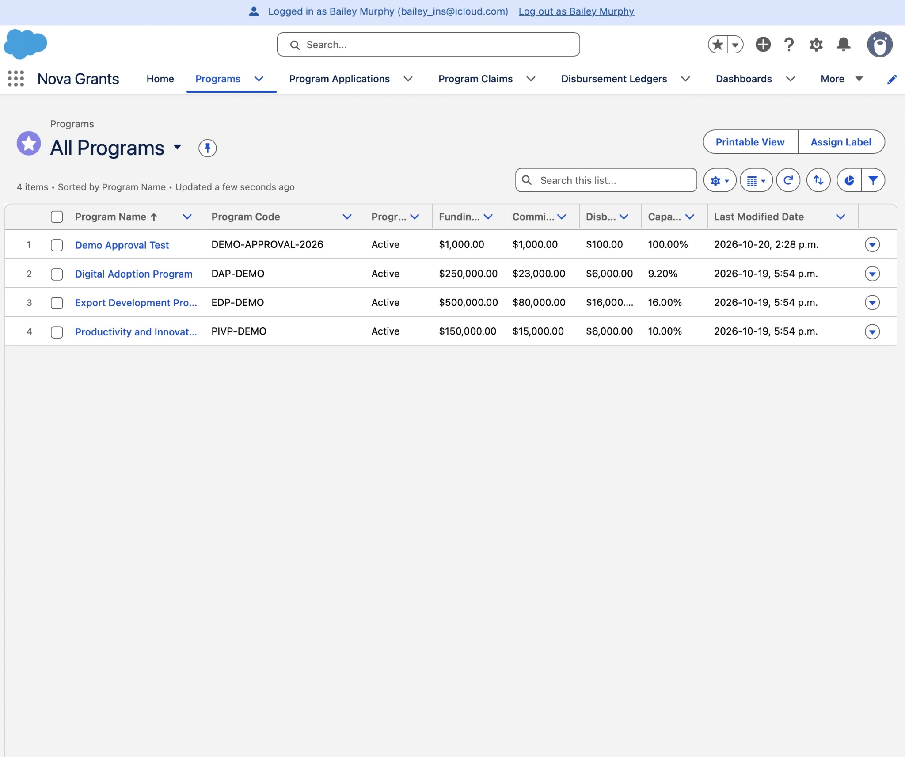
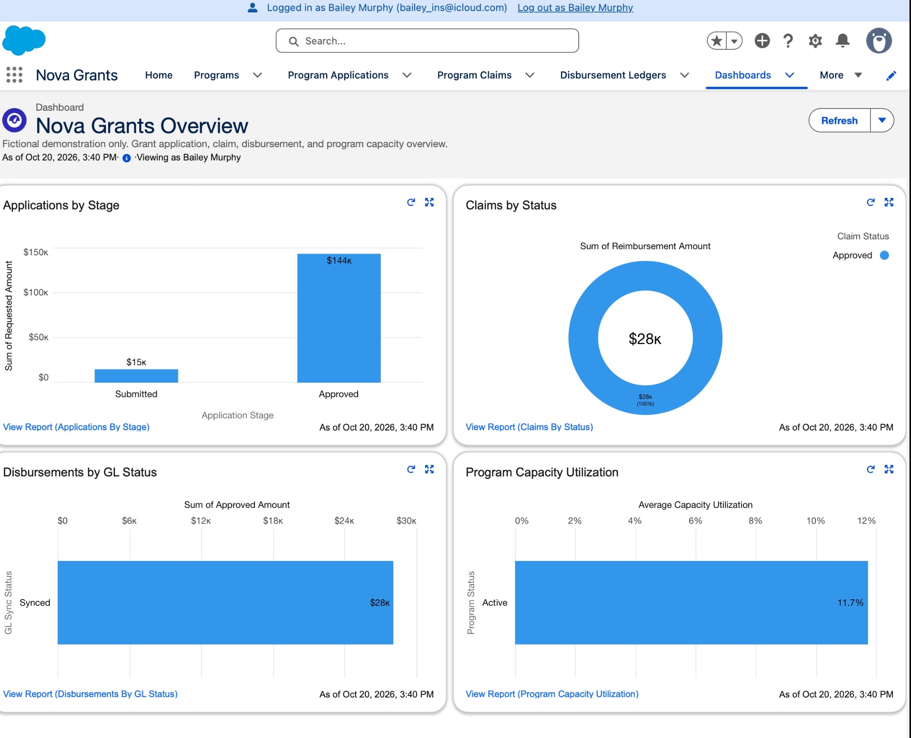
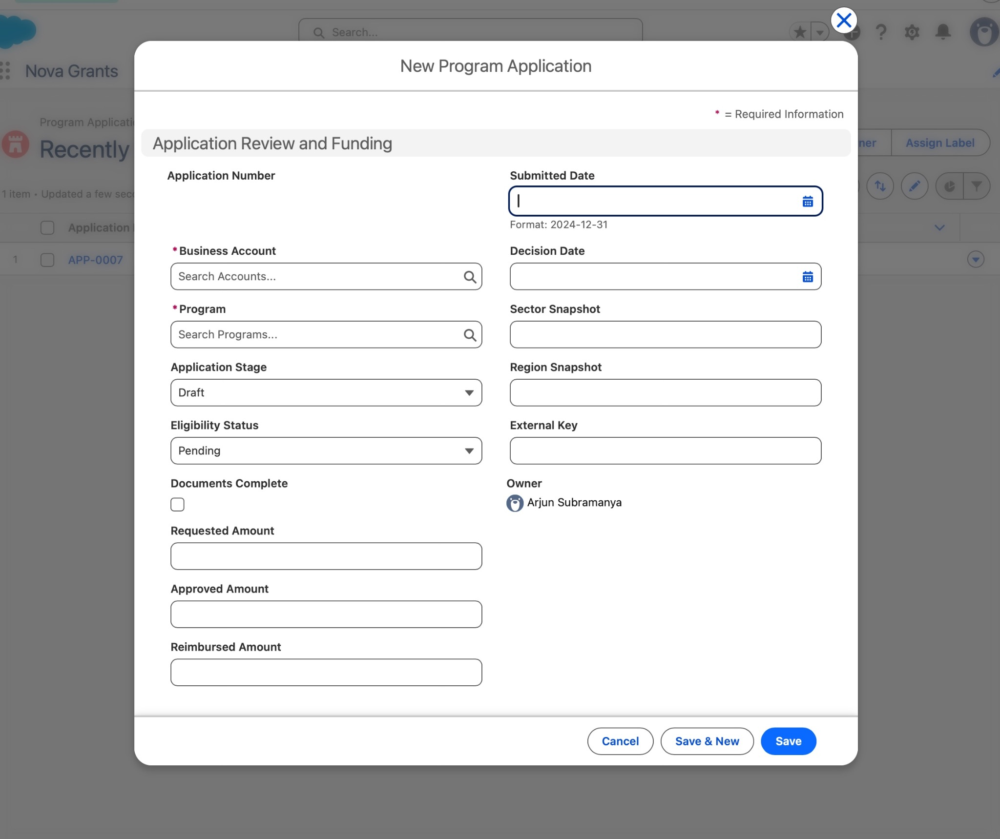
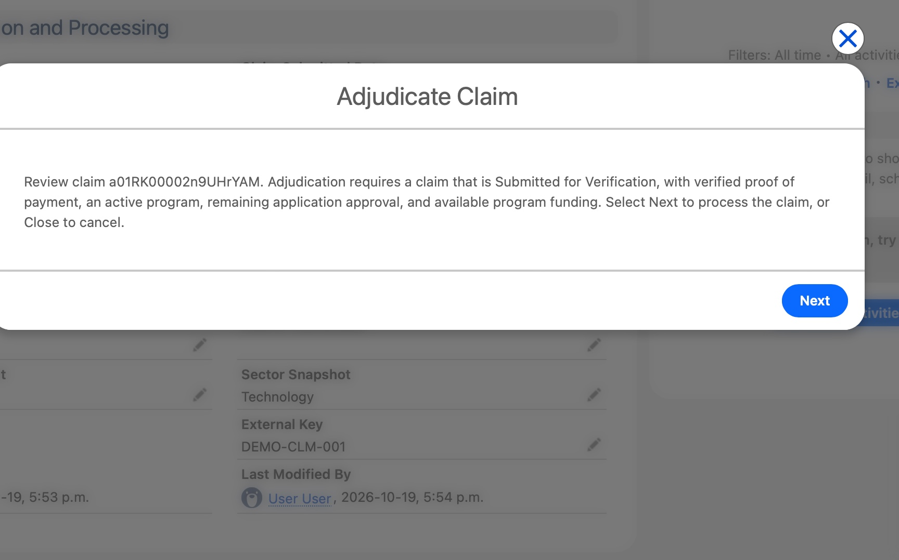
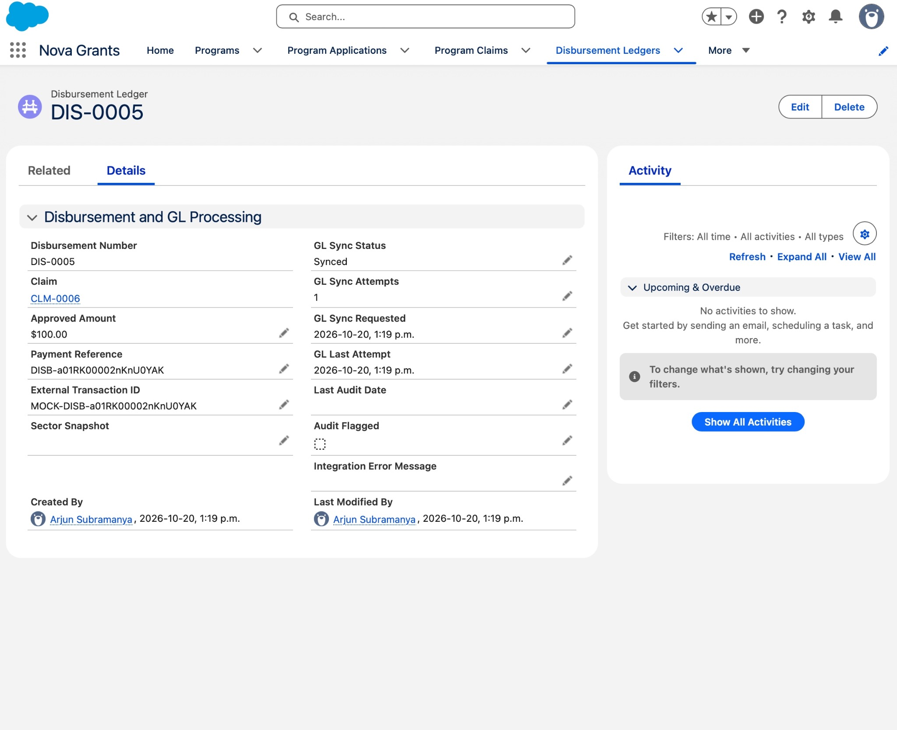

# Nova Grants — Salesforce Grant Management Portfolio

**Nova Scotia Economic Growth & Grant Management Platform** is an independent,
fictional Salesforce demonstration for an economic-development grants team.
It connects applicant intake, funding review, verified claims, reimbursements,
financial oversight, and business outcomes using native Lightning configuration
and focused Apex financial controls.

This is **not an official Invest Nova Scotia or government implementation**.
Program parameters and demonstration records are fictional. No money is transferred
and no live general ledger is connected. **Agentforce is not implemented.**

## Why this project exists

Grant administrators need a consistent view of applicant information, approval
ceilings, invoice verification, and reimbursement history. Fragmented spreadsheets
make duplicate processing, inconsistent permissions, and misleading funding totals
harder to detect.

Nova Grants demonstrates administrator skills in data modeling, Flow design,
permission sets, record sharing, validation, reporting, Lightning page configuration,
and regression-led troubleshooting. Its business outcomes are demonstrable
capabilities, not claims of measured processing-time savings or actual economic impact.

## Verified status

| Evidence | Result |
| --- | --- |
| Owner browser UAT | Claim submission, top-right adjudication result, $100 reimbursement from a $200 invoice at 50%, one Disbursement, Synced integration state, and idempotent repeat verified. |
| Financial proof | APP-0007 / CLM-0006 / DIS-0005; payment reference follows `DISB-<external-key-or-claim-id>`. |
| Reports and dashboard | Owner verified all four reports and all four dashboard charts, including coordinator folder access. |
| Deployed automated regression | **41 passed, zero failed; 92% org-wide coverage** (includes KPI rollup tests). Separate admin and coordinator authorization tests exist. |
| Standalone source check | **156 components validated** with no deployment; 34 test methods passed in Metadata API validation. Validation used the existing demo org, not an empty org. |
| KPI correction | Deployed to `nova-grants-demo` (`0AfRK00000uwl9a0AA`); **39 tests passed, zero failures**; new rollup class/trigger 100% covered. Demo Approval Test initialized from $0 to $1,000 committed; seeded Programs reconciled without mutation. |

Browser evidence does **not** establish that both personas independently completed
adjudication. Do not reset or re-adjudicate CLM-0006 for a presentation. See the
[validation matrix](docs/VALIDATION.md) for the precise evidence and remaining checks.

## Grant lifecycle

1. **Business intake:** `New_Grant_Application` collects fictional business and
   program details, reuses an Account by business number or creates one, and
   creates a Submitted Application for an active program.
2. **Eligibility and review:** reviewers use employee thresholds, document status,
   requested funding, eligibility, and the approved ceiling. This is manual review,
   not automated underwriting.
3. **Assignment and submission:** the owner grants an application-level Edit share
   to the assigned coordinator. Claim access inherits from its parent Application.
4. **Verification and adjudication:** the reviewer submits the Claim, attests to
   reviewed proof of payment, and launches the top-right **Adjudicate Claim** action.
5. **Reimbursement:** permission-gated Apex checks funding, calculates the amount,
   creates a Disbursement, and updates financial totals atomically.
6. **Oversight:** asynchronous mock synchronization, reports, dashboard charts,
   and Account-level Impact Metrics support operational review.

## Five-object business model

```text
Account (business) -------- lookup -------- Application__c -------- lookup -------- Program__c
       |                                        |
       | master-detail                          | master-detail
       +-- Impact_Metric__c                     +-- Claim__c
                                                        |
                                                        | master-detail
                                                        +-- Disbursement__c
```

Account is a standard Salesforce object. Program, Application, Claim, Disbursement,
and Economic Impact Metric are the five business custom objects. `Error_Log__c`
and hierarchy setting `Nova_Grants_Setting__c` are supporting operational metadata.
Impact Metrics belong to the business, not directly to an Application. Error Logs
use a text source-record reference rather than a relational child link.

## Personas and least privilege

- **Arjun Subramanya — Administrator:** configuration, intake and review preparation;
  `Nova_Grants_Admin` explicitly includes the adjudication custom permission.
- **Bailey Murphy — Claims Coordinator:** editable submission/verification fields,
  approved Apex/Flow access, the adjudication permission, and read-only ledger fields.
  No System Administrator or Modify All grant is needed for this persona.
- **Record sharing:** Applications are Private; Claims and Disbursements inherit
  access. A targeted Edit share does not grant Edit to unrelated applications.
- **Folder sharing:** the `Nova Grants Reviewers` public group has View access to
  reporting folders. Membership and persona assignments are org configuration.

The demo coordinator permission set includes View All for object visibility;
View All is not Edit access. This visibility choice is documented rather than
presented as a production assignment model. The standard profile's existing
View Setup permission was not modified.

## Financial and authorization safeguards

- Custom permission `Nova_Grants_Adjudicate_Claims` is required; the service also
  checks actual Claim Edit access. A System Administrator profile alone does not
  automatically satisfy this custom-permission gate.
- Only Submitted for Verification claims with verified proof and an Active
  program can proceed.
- Reimbursement is invoice amount × program percentage, rounded half-up to two
  decimals, capped at the remaining approved Application amount.
- Program cap checks use **live approved Application totals**, not cached
  `Program.Committed_Amount__c`. Commitments and paid dollars are not added again.
- Application, Program and Claim locks, unique payment references, and repeat
  checks protect ordinary idempotency. Exceptions roll back financial writes.
- The Claim guard blocks equivalent direct terminal-status and payout-field
  edits; explicit rejection remains a future enhancement.
- Explicit system-mode DML is limited to guarded financial operations. A private
  writer changes only the computed Program Disbursed total without granting the
  coordinator Program Edit permission.
- The integration worker accepts IDs, not caller-supplied updates; it processes
  Pending/Retrying records and writes only synchronization state and error logs.
  It has no Aura, REST, or invocable entry point enabled for the coordinator.

See [architecture](docs/ARCHITECTURE.md) for transaction boundaries and limitations,
including direct Application overcommitment and untested parallel-load behavior.

## Ledger, mock integration and automation

`FinancialIntegrationQueueable` tracks Pending, Retrying, Failed and Synced states.
`Payment_Reference__c` starts with **`DISB-`**; mock integration's **external
transaction ID** starts with `MOCK-`. These are different fields. A mock reference
is not evidence of a payment or an external financial-system connection.

`Application_Low_Budget_Alert` creates an owner Task when remaining **Application**
approval crosses below 25%. `ScheduledFinancialAudit` implements stale-sync flagging;
no active scheduled audit job was found during final inspection.

## Reporting

Four reports cover Applications by Stage, Claims by Status, Disbursements by GL
Status, and Program Capacity Utilization. Financial Summary reports provide grouped
totals. Four native dashboard charts run as the logged-in viewer.

**Reporting note:** capacity utilization is now **Approved Application commitments /
Program funding cap**. Disbursements are shown separately and are no longer added
to commitments. The [KPI correction details](docs/KPI-PROPOSAL.md) include the
deployment ID, before/after reconciliation, and dashboard refresh guidance.

## Tests and repository validation

Use an existing authorized org and explicitly target it:

```bash
sf apex run test --target-org nova-grants-demo \
  --tests ClaimAdjudicationServiceTest --tests ClaimSubmissionAccessTest \
  --tests NovaGrantsAgentActionsTest --tests FinancialIntegrationQueueableTest \
  --tests ScheduledFinancialAuditTest --code-coverage --result-format human --wait 15

sf project deploy start --dry-run --target-org nova-grants-demo \
  --source-dir force-app --test-level RunSpecifiedTests \
  --tests ClaimAdjudicationServiceTest --tests ClaimSubmissionAccessTest \
  --tests NovaGrantsAgentActionsTest --tests FinancialIntegrationQueueableTest \
  --tests ScheduledFinancialAuditTest

python3 scripts/validate_portfolio.py
```

Tests create isolated records and do not change seeded financial records. Metadata
validation does not prove browser rendering or clean-org installation. See
[setup and deployment instructions](docs/OPERATIONS.md), including licensing,
persona/group assignments, manual sharing, and mock-mode configuration.

## Screenshots

All images are owner-captured from the `nova-grants-demo` org. The original
files were misnamed; the five images below were reorganized to match their
actual content and are stored under `docs/screenshots/`. Unused originals are
preserved in `.local/screenshots-originals/`.

| Nova Grants app navigation | Executive dashboard |
| --- | --- |
|  |  |
| *Programs list with corrected capacity utilization per Program.* | *Coordinator view of all four charts; Program Capacity Utilization shows **Active 11.7%** after excluding the isolated Demo Approval Test Program.* |

| Application form | Claim adjudication | Simulated GL sync |
| --- | --- | --- |
|  |  |  |
| *Standard Program Application record form; production intake is handled by the `New_Grant_Application` Screen Flow.* | *Adjudicate Claim action confirmation with required safeguards listed before processing.* | *DIS-0005 ledger: **Synced** GL status, `DISB-...` payment reference, and `MOCK-...` external transaction ID.* |

See [docs/screenshots/README.md](docs/screenshots/README.md) for capture notes and privacy caveats.

## Demonstration and future work

Future enhancements include assignment automation, explicit rejection, immutable
ledger hardening, production GL authentication and reconciliation, richer impact
reporting, and concurrency/bulk hardening. Home-page redesign and Agentforce are
not part of this completed demonstration.

## Provenance and publication

This standalone source was separated from the project owner's earlier Salesforce
portfolio workspace; unrelated care-ledger components are excluded. See
[NOTICE.md](NOTICE.md). No license grant is invented: owner license selection and
separate publication approval remain required. The [publication plan](docs/PUBLICATION.md)
contains proposed GitHub description/topics and commands; none have been executed.
